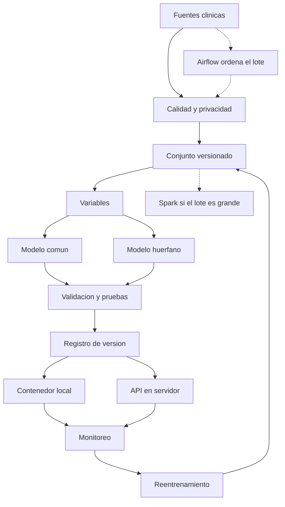

# Pipeline de MLOps: posible enfermedad a partir de síntomas

Un médico entrega los síntomas y unos datos clínicos básicos de un episodio. El sistema estima si es posible que esa persona tenga una enfermedad, y con qué confianza. La decisión sigue siendo del médico. Esto no es un diagnóstico automático.

Hay dos realidades de datos, y las dos tienen que funcionar:

- Enfermedades comunes: muchos pacientes ya confirmados. Se puede entrenar, calibrar y comparar contra un modelo simple.
- Enfermedades huérfanas: muy pocos casos, a menudo confirmados tarde. Un modelo entrenado para acertar la mayoría aprende a ignorarlas. La exactitud sube justo cuando la enfermedad rara se pierde.

Si no hay casos suficientes de una enfermedad concreta, el sistema no le inventa un nombre. Devuelve una alerta de patrón poco frecuente y deja el caso para el especialista.

El médico ve, además, un resumen estable en cinco estados: `ENFERMEDAD TERMINAL`, `ENFERMEDAD CRÓNICA`, `ENFERMEDAD AGUDA`, `NO ENFERMO` y `ENFERMEDAD LEVE`. Esos estados salen de la estimación del modelo y de la duración, con cortes acordados con el equipo clínico. Las reglas se aplican en ese orden. Un cuadro largo e intenso se marca terminal antes de marcarlo crónico. Mientras no haya un modelo entrenado, el servicio responde con una función determinista y el mismo contrato.

Los cambios frente a la propuesta inicial están en [CHANGELOG.md](CHANGELOG.md). El dibujo del proceso está en [diagrama-pipeline.svg](diagrama-pipeline.svg).

## Suposiciones

El problema es abierto. Estas son las suposiciones con las que se puede poner en marcha, y lo que pasa si no se cumplen.

- Solo entran síntomas estructurados. La nota clínica libre y las imágenes quedan fuera. Si el dato viene en texto libre, esta versión no lo lee: el lote se rechaza en calidad.
- La unidad para partir los datos es el paciente. Varias consultas de la misma persona no pueden quedar a la vez en entrenamiento y en prueba. Si el identificador seudónimo cambia, la métrica queda inflada.
- Una clase con al menos 200 pacientes confirmados se trata como común. De 20 a 199, como huérfana. Por debajo de 20 no hay clase con nombre: hay alerta genérica. Esos mínimos se escriben en la ficha del modelo y se acuerdan con el equipo clínico. Si una clase cruza un umbral, cambia de camino en el siguiente entrenamiento.
- La etiqueta de una huérfana puede llegar tarde. Se guardan por separado la fecha de la consulta y la fecha de confirmación. Un episodio sin diagnóstico permanece sin etiqueta hasta cumplir 12 meses, o hasta que aparezca una confirmación. Entrenarlo antes como sano enseña al modelo a borrar los casos que hay que encontrar.
- La exactitud global no decide. Perder una huérfana pesa más que una alerta que el médico descarta. El umbral de esas clases lo fija el equipo clínico.
- Nombre y documento no entran al entrenamiento (Ley 1581 de 2012). Si vienen mezclados con los síntomas, el lote se rechaza.
- Fiebre, dolor y duración no identifican una sola enfermedad. La salida es compatibilidad, con un nivel de confianza.
- Las sedes no comparten los mismos códigos. Hace falta un diccionario de síntomas con versión. Un código sin mapa se marca como desconocido.
- Mientras no haya modelo entrenado, responde la función determinista. El médico ve el mismo contrato el día en que el modelo la reemplace.
- La respuesta cabe en segundos. La entrada de una consulta son pocos números, así que el contenedor corre en el computador del médico. Si más adelante el modelo no cupiera, el médico llama a la misma API en el servidor. El contrato no cambia.

## Dos formas de uso

Las dos usan la misma imagen.

- Computador local. El médico ejecuta `docker run` cuando los recursos que pide la solución son bajos. Abre la página en su equipo. La historia clínica no sale de ese equipo.
- Petición. La misma imagen corre en un servidor del hospital o en una instancia pequeña que solo ejecuta el contenedor. El médico llama la misma API. El proveedor de nube no cambia el contrato: cambian el sitio donde corre la imagen y quién la opera.

La imagen se publica en GitHub Container Registry. El computador local y el servidor jalan la misma versión. GitHub Actions construye esa imagen solo después de que las pruebas pasan.

## Herramientas

Cada herramienta está aquí porque resuelve un paso concreto.

- Git y GitHub guardan el código, el manifiesto de datos y el manifiesto del modelo. Los cambios entran por pull request.
- Python 3.12 es el lenguaje del entrenamiento y del servicio.
- pandas arma la tabla de síntomas cuando el lote cabe en una máquina.
- scikit-learn entrena la regresión logística (referencia que se puede explicar) y la potenciación de gradiente (modelo principal). La entrada es una tabla corta.
- pytest fija la puerta del servicio: cinco casos, uno por estado, y el rechazo de valores fuera de rango.
- Docker empaqueta esa puerta y el modelo en una imagen.
- GitHub Actions corre las pruebas en cada cambio y publica la imagen solo si pasan.
- GitHub Container Registry entrega esa imagen al computador del médico y al servidor.
- Un manifiesto versionado registra datos, código, métricas y umbrales. No se despliega un archivo suelto.
- El servicio escribe cada predicción aceptada y expone el reporte de conteos y últimas consultas.
- Airflow ordena los trabajos por lotes que ya tienen calendario.
- Spark parte las filas cuando el lote de historias no cabe en una máquina. Una consulta de un paciente no pasa por Spark.

## Etapas

Cada etapa tiene una condición para avanzar. Sin esa condición no se promueve el modelo.

### E1. Ingesta

- Entra: la extracción de la historia clínica de la sede y las confirmaciones del especialista, del laboratorio o del estudio genético. El catálogo de fenotipos de enfermedades huérfanas dice qué síntomas son plausibles. No aporta pacientes. No se mezclan pacientes de repositorios públicos que no hayan pasado el control de calidad.
- Sale: un lote crudo, solo lectura, con identificador y fecha.
- Herramienta: un archivo de lote citado por el manifiesto. Airflow dispara este paso cuando la sede entrega un lote nuevo.
- Por qué: los datos clínicos de la sede llegan por lotes, no como un flujo continuo. Un archivo con identificador no pisa al lote anterior.
- Suposición: la sede puede exportar un lote con un esquema estable.
- Implicación: si el esquema cambia sin avisar, E2 rechaza el lote entero. Nada de ese lote entra a entrenamiento.
- Sigue si: el esquema se reconoce y el lote queda identificado, sin pisar un lote anterior.

### E2. Calidad y privacidad

- Entra: el lote crudo.
- Sale: un lote aceptado, o un rechazo con informe.
- Herramienta: comprobaciones en Python, las mismas que el servicio usa para no aceptar una consulta inválida.
- Por qué: la regla de un campo tiene que ser una sola. Si el entrenamiento acepta una fiebre que el servicio rechaza, el modelo ve casos que el médico nunca podrá enviar.
- Rangos de esta versión: fiebre de 34 a 43 °C, dolor de 0 a 10, días de 0 a 3650, número de síntomas de 0 a 30. Fuera de ahí, el registro se rechaza.
- Suposición: nombre y documento vienen en columnas distintas de los síntomas, y una consulta repetida se puede reconocer.
- Implicación: si el identificador viene dentro de un texto clínico, el lote se rechaza. Esta versión no intenta limpiar nota libre.
- Sigue si: los campos obligatorios están, los rangos cierran, no hay consultas duplicadas y los identificadores directos quedaron aparte. Un lote rechazado no entra a entrenamiento.

### E3. Conjunto de datos versionado

- Entra: los lotes aceptados.
- Sale: un conjunto `vN` con un manifiesto: pacientes, casos por clase, fechas, sede e identificadores de los lotes que lo componen.
- Herramienta: el manifiesto vive en Git. El archivo del lote, si pesa, queda fuera del repositorio y el manifiesto lo cita.
- Por qué: cada experimento tiene que poder decir con qué datos se entrenó. Git alcanza para el manifiesto. Meter el lote clínico dentro de Git no aporta trazabilidad y sí mezcla datos sensibles con el código.
- Partición de partida: 70 % entrenamiento, 15 % validación y 15 % prueba, por paciente. Un bloque de otro período queda fuera y no se usa para elegir umbrales. En validación se elige el umbral. La prueba se mira una vez.
- Suposición: cada paciente tiene un identificador seudónimo que no cambia entre consultas.
- Implicación: si la sede regenera ese identificador, la misma persona puede entrenar y probar el modelo. El resultado deja de servir para promover.
- Sigue si: el conjunto es inmutable y cada experimento futuro lo cita.

### E4. Variables

- Entra: el conjunto `vN`.
- Sale: la matriz de variables y el diccionario de síntomas de esa versión.
- Herramienta: una función en pandas. El entrenamiento y el servicio llaman a la misma función.
- Por qué: si la preparación se reescribe en el servicio, la consulta del médico ya no es la que el modelo vio al entrenar.
- Entrada mínima de esta versión: fiebre, dolor, días, número de síntomas, edad y sexo. Edad y sexo ajustan. No son el único predictor. Laboratorio estructurado, si la sede lo tiene, puede entrar después por esta misma etapa.
- Un síntoma desconocido se marca. No se improvisa un código.
- Suposición: las sedes pueden mapear sus códigos al diccionario versionado.
- Implicación: sin ese mapa, el síntoma queda desconocido. Si los desconocidos superan el 5 % de las consultas, E9 alerta y no se sigue entrenando con un diccionario roto.
- Sigue si: el mismo código de preparación corre en el entrenamiento y en el servicio.

Cuando el lote no cabe en una máquina, esta etapa y la limpieza de E2 corren sobre Spark, como se describe más abajo. La función que define cada variable es la misma.

### E5a. Modelo de enfermedades comunes

- Entra: las variables de las clases que superan el mínimo.
- Sale: un modelo de referencia y un modelo principal.
- Herramienta: scikit-learn. La referencia es una regresión logística. El modelo principal es potenciación de gradiente sobre la tabla de síntomas.
- Por qué: la referencia se puede explicar variable por variable. El modelo principal solo se queda si iguala o mejora esa referencia en la puerta de E6. Con una tabla corta no hace falta entrenar una red.
- Suposición: la clase tiene al menos 200 pacientes confirmados. Ese número queda escrito en la ficha.
- Implicación: si al contar de nuevo la clase queda por debajo de 200, sale de este camino. Entre 20 y 199 pasa a E5b. Por debajo de 20 queda la alerta genérica.
- Sigue si: el candidato iguala o mejora la puerta de E6 frente a la regresión logística.

### E5b. Modelo de enfermedades huérfanas

- Entra: la representación de síntomas ya entrenada en el camino común, y los casos raros.
- Sale: una adaptación de pocos ejemplos (prototipos o una capa ajustada), o la decisión explícita de no nombrar la clase.
- Herramienta: la misma representación de síntomas del modelo común. No se entrena un modelo desde cero con un puñado de casos.
- Por qué: con decenas de pacientes, un modelo grande memoriza el ruido. Reusar la representación ya aprendida con muchos casos comunes es lo que se puede calibrar.
- De 20 a 199 confirmados hay adaptación. Por debajo de 20 no hay clase con nombre: hay alerta genérica y el caso queda para el especialista. Esa carencia se escribe.
- Un aumento de datos, si se usa, es una variación clínica revisable. No es un paciente inventado presentado como real.
- Suposición: los pocos casos de la huérfana comparten síntomas con la representación ya entrenada.
- Implicación: si la enfermedad no se expresa en esas variables, no se le pone nombre. El médico recibe la alerta genérica.
- Sigue si: hay al menos 20 confirmados, o queda documentado que solo habrá alerta genérica.

### E6. Validación y puerta de promoción

- Entra: el candidato, la validación (ahí se elige el umbral) y una prueba que se mira una vez.
- Sale: un informe de sí o no, y la ficha del modelo.
- Herramienta: el informe de métricas del régimen, la revisión de una muestra de falsos negativos, y pytest sobre el contrato del servicio.
- Por qué: la métrica del modelo no prueba que el médico reciba el estado correcto. pytest cubre ese contrato. La muestra clínica cubre los casos que la métrica puede dar por buenos.
- Si una clase tiene menos de 50 pacientes, esa clase se valida dejando un paciente fuera en cada vuelta.
- Comunes: el candidato se promueve si iguala o mejora la sensibilidad de la regresión logística en el umbral clínico y la calibración no empeora. En cada tramo de probabilidad, la frecuencia observada se mantiene cerca de la probabilidad anunciada.
- Huérfanas: el candidato se promueve si la sensibilidad de la alerta es al menos 0,80 sobre los confirmados de prueba. La métrica de apoyo es PR-AUC. La exactitud global no es puerta.
- Un médico revisa una muestra de falsos negativos antes del sí.
- pytest, sobre la imagen, exige estos cinco casos. El orden de los números es fiebre, dolor, días y número de síntomas.

| Fiebre | Dolor | Días | Síntomas | Estado |
| --- | --- | --- | --- | --- |
| 36,6 | 1 | 1 | 0 | NO ENFERMO |
| 37,6 | 4 | 4 | 2 | ENFERMEDAD LEVE |
| 39,2 | 8 | 2 | 6 | ENFERMEDAD AGUDA |
| 37,0 | 3 | 120 | 2 | ENFERMEDAD CRÓNICA |
| 39,0 | 9 | 240 | 8 | ENFERMEDAD TERMINAL |

El caso de 240 días también cumple el corte de crónica (90 días). Se evalúa antes la regla terminal: 180 días o más, dolor 8 o más y 6 síntomas o más. Por eso ese caso es terminal.

La función determinista, mientras ocupa el lugar del modelo, aplica estas reglas en orden:

1. `ENFERMEDAD TERMINAL` si los días son 180 o más, el dolor es 8 o más y los síntomas son 6 o más.
2. `ENFERMEDAD CRÓNICA` si los días son 90 o más.
3. `ENFERMEDAD AGUDA` si la fiebre es 38,5 °C o más, el dolor es 7 o más, o los síntomas son 5 o más.
4. `NO ENFERMO` si la fiebre es menor de 37,5 °C, el dolor es 2 o menos, los síntomas son 1 o menos y los días son 3 o menos.
5. `ENFERMEDAD LEVE` en cualquier otro caso dentro de los rangos.

Un valor fuera de rango no es un estado. La consulta se rechaza y no se anota en el reporte.

- Suposición: hay un bloque de otro período que nadie usó para elegir umbrales, y un médico puede revisar la muestra de falsos negativos.
- Implicación: si el umbral se eligió mirando la prueba, o si nadie revisó los falsos negativos, el candidato no se promueve aunque el número se vea bien.
- Sigue si: se cumple la métrica del régimen, el médico revisó la muestra y pytest pasa.

### E7. Registro

- Entra: el candidato aprobado en E6.
- Sale: una versión inmutable.
- Herramienta: un manifiesto en Git con el conjunto `vN`, el código, las métricas y los umbrales. La imagen cita ese manifiesto.
- Por qué: dentro de un año tiene que poder decirse qué datos, qué código y qué cortes produjeron la respuesta que vio el médico.
- Suposición: un candidato aprobado produce un solo paquete, y ese paquete no se edita después de registrarlo.
- Implicación: un archivo de modelo copiado a mano, fuera del manifiesto, no se despliega.
- Sigue si: lo que va a correr es exactamente lo registrado.

### E8. Despliegue

- Entra: la versión registrada.
- Sale: una imagen de contenedor con página para el médico y API. La respuesta lleva estado, razón y versión.
- Herramienta: Docker para la imagen, pytest como condición, GitHub Actions para construirla y GitHub Container Registry para publicarla.
- Por qué: el médico local y el servidor tienen que ejecutar el mismo paquete. Una imagen cumple eso. Publicarla solo después de las pruebas evita que una versión rota llegue al médico.
- Uso local: `docker run` de esa imagen. Cabe en un computador porque la entrada de una consulta son pocos números.
- Uso por petición: la misma imagen corre en un servidor del hospital o en una instancia pequeña. El médico llama la misma API. La historia clínica no sale a un servicio público.
- Hasta que exista el entrenamiento, la imagen publica la función determinista en el lugar del modelo, con el mismo contrato. Cuando el modelo existe, se sustituye dentro de la imagen. La forma de usarla no cambia.
- Suposición: el paquete cabe en un contenedor pequeño y alguien puede ejecutarlo, el médico en su equipo o el hospital en un servidor.
- Implicación: si una versión futura ya no cabe en el equipo del médico, ese médico pasa a la petición. No se cambia la API para ese caso.
- Sigue si: la imagen se construye, los cinco casos fijos responden bien, los valores fuera de rango se rechazan y la versión de la imagen es la versión del modelo.

### E9. Monitoreo

- Entra: las consultas reales y, cuando llegan, las confirmaciones.
- Sale: alertas, y un reporte que el médico puede abrir.
- Herramienta: el servicio escribe cada predicción aceptada. El reporte muestra el conteo de los cinco estados (en cero si aún no hay), las últimas cinco consultas y la fecha de la última predicción. Una consulta rechazada por rango no se escribe.
- Por qué: el día del despliegue todavía no existe la etiqueta real. Lo que sí se puede vigilar es qué está entrando y qué está respondiendo el servicio.
- También se vigilan la latencia y los errores, la proporción de cada estado, y los síntomas fuera del diccionario. Hay alerta si los desconocidos superan el 5 % de las consultas. Hay alerta si la proporción de episodios con fiebre de 38,5 °C o más, o con 90 días o más, se desplaza más de 10 puntos porcentuales frente al conjunto de entrenamiento. Esos cortes son los mismos del lenguaje de los estados.
- La sensibilidad real se recalcula cuando la etiqueta madura, sobre todo en huérfanas. Esa cifra no se puede ver el día del despliegue.
- Suposición: las confirmaciones vuelven al sistema, aunque sea meses después.
- Implicación: mientras no vuelven, una alerta de E9 habla de deriva o de fallos, no de sensibilidad clínica. No se reentrena una huérfana solo con esa alerta.
- Sigue en observación permanente.

### E10. Reentrenamiento

- Entra: etiquetas ya maduras, o una alerta de deriva de E9 en el camino de las comunes.
- Sale: un candidato que vuelve a E5.
- Herramienta: Airflow lanza el trabajo. El candidato reemplaza al modelo vigente solo si gana otra vez la puerta de E6.
- Por qué: el orden importa. Primero el conjunto versionado, después el entrenamiento, después la puerta. Un calendario escrito en una libreta no muestra qué paso falló.
- Un episodio sin diagnóstico permanece sin etiqueta hasta cumplir 12 meses, o hasta que aparezca una confirmación.
- Las comunes se reentrenan cada trimestre, o el mismo día de una alerta de deriva. Las huérfanas se reentrenan solo cuando entra un grupo nuevo de confirmaciones. Un calendario vacío las haría oscilar.
- Una enfermedad nueva sin casos locales no crea una clase. Sigue la alerta genérica y queda escrita la carencia.
- Suposición: toda etiqueta que entra a este paso ya maduró.
- Implicación: una confirmación de la misma semana no dispara por sí sola el reentrenamiento de una huérfana. Entra al grupo y espera a que ese grupo cierre.
- Reemplaza al modelo vigente solo si gana otra vez la puerta de E6. Si no gana, sigue en servicio la versión registrada.

## Lotes: Airflow y Spark

La consulta de un paciente no usa estas dos herramientas. Las usa el trabajo por lotes.

Airflow ordena tres trabajos que ya tenía el proceso:

1. Llega un lote clínico. Se valida en E2 y, si pasa, se publica el conjunto en E3.
2. Cada trimestre se reentrenan las enfermedades comunes. El modelo nuevo reemplaza al vigente solo si pasa E6.
3. Las huérfanas se reentrenan solo cuando entra un grupo nuevo de confirmaciones.

El médico no espera ese calendario. Su consulta sigue siendo el contenedor local o la API.

Spark entra cuando el lote trae muchas historias a la vez y hay que limpiarlas, armar las variables o puntuarlas juntas. Parte las filas. Si el lote cabe en una máquina, sigue el script de Python con pandas y Spark no se arranca. Puntuar el lote no cambia la consulta de un paciente: esa consulta sigue en la imagen de E8.

Suposición: se sabe, antes de lanzar el lote, si cabe en una máquina. Implicación: si se arranca Spark para un lote pequeño, el resultado tiene que ser el mismo que el del script. La función de cada variable no cambia con la herramienta.

## Diagrama

El dibujo está en [diagrama-pipeline.svg](diagrama-pipeline.svg). Se lee de arriba abajo.

Airflow queda aparte, como el ordenador de los lotes. Spark queda entre el conjunto versionado y las variables, y solo si el lote es grande. E5a y E5b avanzan en paralelo y se encuentran en la puerta. El registro se abre en dos usos: el computador del médico y la petición al servidor. Los dos llegan al monitoreo. La línea verde devuelve las confirmaciones nuevas a E3. Un candidato que no pasa E6 no se despliega.

## Fuera de esta versión

Texto libre de la nota clínica, imagen diagnóstica y certificación como dispositivo médico. Entran después por el mismo camino: variables nuevas en E4, la misma puerta E6 y la misma imagen en E8.
